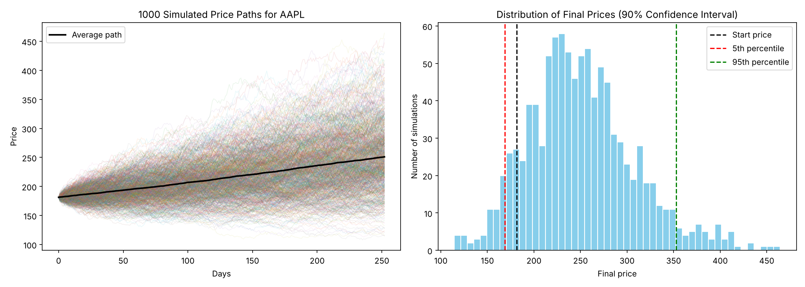

# 📈 Monte Carlo Stock Price Simulator

Simulates thousands of possible future price paths for a stock using probability and random sampling.

[](https://colab.research.google.com/github/PrabhatDev28/monte-carlo-stock-simulator/blob/main/Monte_Carlo_Stock_Simulator.ipynb)




*Example: 1,000 simulated one-year price paths for TMPV.NS (Tata Motors Passenger Vehicles) and the distribution of final prices.*

## Features
- 1,000+ simulated price paths
- Scenario distribution of final prices
- 90% confidence interval (5th to 95th percentile)
- Chance-of-profit estimate
- Works on any stock available on Yahoo Finance

**Tech:** Python, NumPy, pandas, Matplotlib, yfinance

## How it works
1. Download past prices for a stock using `yfinance`.
2. Calculate the average daily return and the volatility.
3. Generate random daily returns from a normal distribution, 1,000 times.
4. Compound those returns into 1,000 possible price paths.
5. Summarize the final prices: average, median, best/worst case, chance of profit.
6. Plot the paths and the distribution of final prices.

## Quick start

**Option 1: Google Colab (no installation)**
Click the **Open in Colab** badge above, then choose **Runtime → Run all**.

**Option 2: Your own computer**
```bash
git clone https://github.com/PrabhatDev28/monte-carlo-stock-simulator.git
cd monte-carlo-stock-simulator
pip install -r requirements.txt
python monte_carlo_simulator.py
```

Change `TICKER`, `HISTORY_PERIOD`, `DAYS` or `SIMULATIONS` at the top of the file to experiment. Indian stocks use `.NS`, for example `TMPV.NS` or `RELIANCE.NS`.

## How to read the results
| Output | Meaning |
|---|---|
| Median final price | The typical outcome (half the paths end above, half below) |
| 5th–95th percentile | The range in which 90% of simulations ended |
| Chance of profit | Share of paths that ended above the starting price |
| Daily volatility | How much the price jumps around each day |

## Project structure
```
├── Monte_Carlo_Stock_Simulator.ipynb   # Google Colab version
├── monte_carlo_simulator.py            # Python script version
├── requirements.txt
├── simulation_results.png
└── README.md
```

## Limitations
This is a learning project. It assumes returns are normally distributed and that past average and volatility continue into the future, which real markets don't guarantee. **Not financial advice.**

## License
MIT
